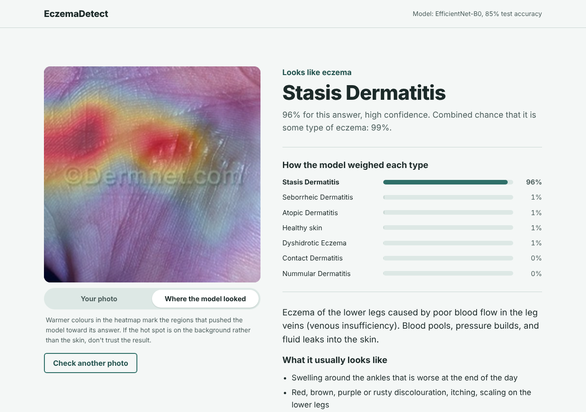

# EczemaDetect

Upload a photo of skin and get:

* **Is it eczema?** — probability that the photo shows eczema vs healthy skin
* **Which type?** — Atopic, Contact, Dyshidrotic, Nummular, Seborrheic or Stasis dermatitis
* **Where the model looked** — a Grad-CAM heatmap over the photo
* **Why it happens and what to do** — causes/triggers, self-care, treatments a clinician may offer, when to see a doctor, and red-flag symptoms

> A learning project, **not a medical device**. Predictions can be wrong and the model only knows 7 classes.



---

## Results (held-out test set, 1,538 images)

| Metric | EfficientNet-B0 (transfer learning, deployed) | Simple CNN (from scratch) |
|---|---|---|
| Accuracy (7 classes) | **84.9%** | 57.5% |
| Macro-F1 | **0.850** | 0.573 |
| Top-2 accuracy | **94.6%** | 74.6% |
| Eczema-type accuracy (eczema images only) | **82.1%** | 51.0% |
| Eczema vs normal accuracy* | **100.0%** | 98.6% |

Per-class F1 (EfficientNet): Atopic Dermatitis 0.78, Contact Dermatitis 0.92, Dyshidrotic Eczema 0.78, Normal 1.00, Nummular Dermatitis 0.77, Seborrheic Dermatitis 0.86, Stasis Dermatitis 0.84.

\* Eczema-vs-normal looks perfect, but don't read much into it: the "Normal" photos come from different sources than the
eczema photos (see *Dataset audit*). Expect it to be much worse on real phone photos.

**Reading the curves:** EfficientNet (10 epochs, ~2 h on a 2-core CPU) was still improving slowly, with a moderate
train/val gap. The from-scratch CNN (15 epochs, 128 px) is *underfitting*: train accuracy sits below validation
(augmentation + dropout make training harder than validation) and both are still rising, so it needs more epochs,
larger images or more capacity. Pretrained features are what close most of the 27-point gap.
Mixed up most often: Nummular ↔ Dyshidrotic, Atopic ↔ Nummular/Dyshidrotic, Stasis → Atopic.


Plots: `reports/*_curves.png` (training curves) and `reports/*_confusion.png` (confusion matrices).
Full numbers: `reports/*_test_report.json`.

---

## Quick start (Windows, PowerShell)

```powershell
cd "C:\Users\samri\Desktop\Personal Projects\ML Project\EczemaDetect"
python -m venv .venv
.\.venv\Scripts\Activate.ps1
pip install -r requirements.txt          # for an NVIDIA GPU, first install torch from pytorch.org

# run the dashboard with the trained model in models/
uvicorn backend.app:app --port 8000
# open http://localhost:8000
```

## Re-train it yourself

```powershell
# 1. audit + clean split  ->  data/splits.csv, data/audit.json
python src/prepare_data.py --raw Eczema_dataset

# 2a. the from-scratch CNN (learning exercise)
python src/train.py --arch simple_cnn --img-size 128 --epochs 15 --lr 3e-3 --batch-size 64   # try --epochs 40 --img-size 160 on a GPU

# 2b. transfer learning: EfficientNet-B0 (the model the dashboard uses)
python src/train.py --arch efficientnet_b0 --img-size 224 --epochs 10 --lr 1e-3 --freeze-epochs 1

# 3. evaluate on the untouched test split (+ calibrates confidences)
python src/evaluate.py --ckpt models/simple_cnn.pt
python src/evaluate.py --ckpt models/efficientnet_b0.pt
```

If training stops part-way, add `--resume` to continue from `models/<arch>_last.pt`.
`--limit 300 --epochs 1` gives a 1-minute smoke test. On a laptop CPU, EfficientNet takes
~12 min/epoch; on a GPU it's under a minute. `models/efficientnet_b0_imagenet.pth` holds the
ImageNet starting weights (if it's missing, `timm` downloads them).

---

## How it works

```
photo ─▶ resize 256 / centre-crop 224 ─▶ normalise ─▶ CNN ─▶ 7 logits ─▶ softmax(logits / T) ─▶ probabilities
                                                       │
                                                       └─ Grad-CAM on the last conv layer ─▶ heatmap
```

**Two models, on purpose**

| | `simple_cnn` | `efficientnet_b0` |
|---|---|---|
| Starts from | random weights | ImageNet-pretrained weights |
| Size | 1.2 M params | 4.0 M params |
| Why | see every layer and learn how CNNs train | best accuracy with ~7k images |

`src/eczema/models.py` → `SimpleCNN` is 4 blocks of *Conv → BatchNorm → ReLU ×2 → MaxPool*
(32 → 64 → 128 → 256 channels), then global-average-pool, dropout and one linear layer.
Each block halves the image size and doubles the channels: early filters detect edges and colour,
later ones detect scale, blisters and patch shapes.

**Training recipe** (`src/train.py`): AdamW, linear warm-up + cosine learning-rate decay,
label smoothing 0.1, augmentation (random crops, flips, ±20° rotation, brightness/contrast jitter
with almost no hue jitter because redness matters), best checkpoint chosen by validation macro-F1,
early stopping. For EfficientNet, epoch 1 trains only the new 7-class head ("frozen backbone")
so the random head doesn't wreck the pretrained features, then everything is fine-tuned.

**Evaluation** (`src/evaluate.py`): test-time augmentation (average with mirrored image),
temperature scaling fitted on the validation set so "80 % confident" really means ~80 %,
per-class precision/recall, confusion matrix, and eczema-vs-normal sensitivity/specificity.

**Backend** (`backend/`): FastAPI. `POST /api/predict` returns the prediction, all class
probabilities, an uncertainty flag (top probability < 45 %), a "doesn't look like skin" warning,
the Grad-CAM image and the matching entry from `backend/knowledge.json`
(causes, self-care, treatments, when to see a doctor; sourced from the AAD and National
Eczema Association). `GET /api/health` reports the model and its test metrics.

**Frontend** (`frontend/`): plain HTML/CSS/JS served by the backend at `/`. To host it elsewhere,
set `window.ECZEMA_API = "https://your-api"` before `app.js` loads.

---

## Dataset audit — read this before trusting any accuracy number

`src/prepare_data.py` found these problems in the Kaggle folders:

| Problem | Count |
|---|---|
| `test/test/Normal` is a byte-identical copy of `train/train/Normal` | 1,579 images |
| Exact duplicate files (anywhere) | 2,025 |
| Same image filed under two different eczema types | 149 |
| Near-duplicate pairs (same photo, re-saved/resized; 256-bit dHash ≤ 12 bits apart) | 852 |

Training on the original folders would report inflated test accuracy (Normal would be ~100 %
because the test images *are* training images). The script removes duplicates and conflicting
labels and splits by near-duplicate *group* (70/15/15, stratified), giving **10,226 clean images**.

**Known limitations**

* **Source shortcut risk:** many disease photos come from DermNet and carry a "©Dermnet.com"
  watermark, while "Normal" photos come from other sources (stock photos, hand datasets).
  A CNN can partly learn "watermark/clinical photo style ⇒ eczema". Eczema-vs-normal accuracy
  is therefore optimistic for real phone photos. Check the Grad-CAM heatmap.
* Labels come from a public dataset, not verified by a dermatologist for this project.
* Mostly lighter skin tones; performance on darker skin is unknown and likely worse.
* The model cannot recognise anything outside its 7 classes (psoriasis, ringworm, scabies,
  acne, skin cancer...). It will still pick the closest of its 7.

**Ideas to improve it**

* Add an "other skin condition" class (e.g. from DermNet/HAM10000/Fitzpatrick17k) so the model can say "not eczema, but not healthy either".
* Crop/inpaint watermarks or add healthy-skin photos from the same clinical sources.
* Try bigger backbones (EfficientNet-B2, ConvNeXt-Tiny) on a GPU, mixup/cutmix, longer training.
* Collect a small set of real phone photos as a "real-world" test set.

---

## Project structure

```
EczemaDetect/
├─ src/
│  ├─ prepare_data.py      # audit + dedupe + leak-free split
│  ├─ train.py             # training loop (both models)
│  ├─ evaluate.py          # test metrics, confusion matrix, calibration
│  └─ eczema/              # shared code: config, dataset/transforms, models
├─ backend/
│  ├─ app.py               # FastAPI app (API + serves the dashboard)
│  ├─ inference.py         # model loading, prediction, Grad-CAM
│  └─ knowledge.json       # causes / care / treatments per class
├─ frontend/               # index.html, styles.css, app.js
├─ models/                 # trained checkpoints (*.pt)
├─ reports/                # curves, confusion matrices, test reports
└─ data/                   # splits.csv, audit.json
```

`src/train_cnn.py` and `dataset/Model.py` are the original Keras drafts, kept for reference
(they don't run as-is: missing imports, `data/` folder path).
